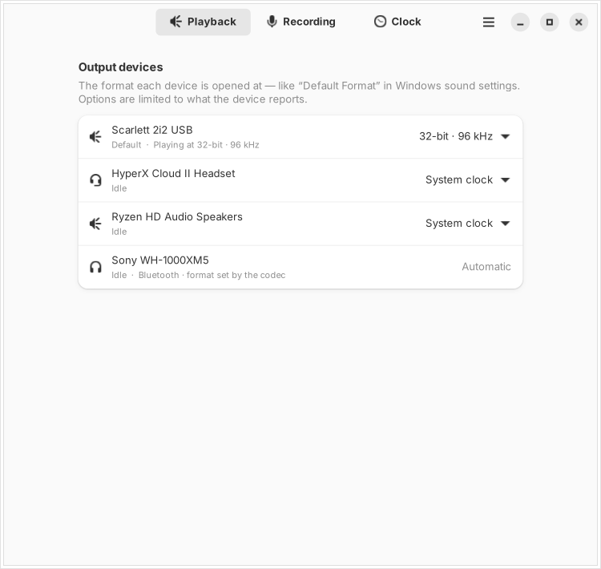
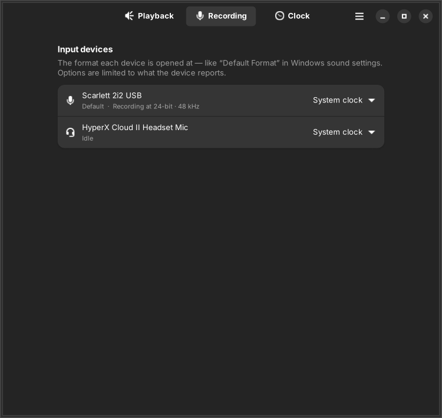
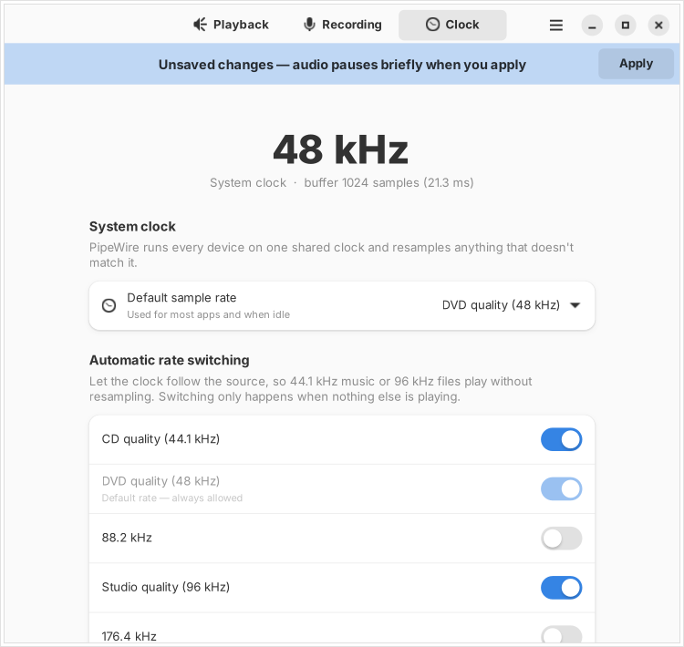
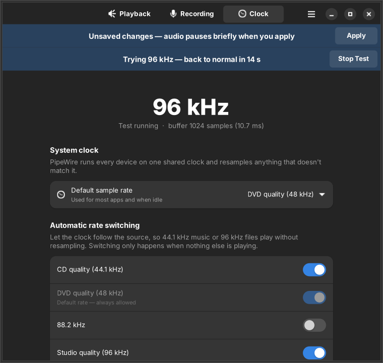
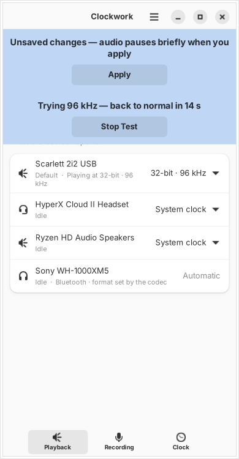

<div align="center">


# Clockwork

**Sample rate and bit depth control for every speaker, headset and microphone on Linux.**

The *“16 bit, 44100 Hz (CD Quality)”* dropdown Windows has, built for PipeWire.

[](LICENSE)




</div>

---

## Contents

- [Why Clockwork](#why-clockwork)
- [Features](#features)
- [Screenshots](#screenshots)
- [Installation](#installation)
- [Using the app](#using-the-app)
- [Command line](#command-line)
- [How it works](#how-it-works)
- [Troubleshooting](#troubleshooting)
- [Limitations](#limitations)
- [Development](#development)
- [License](#license)

## Why Clockwork

On Windows you open *Sound settings → Device properties → Advanced* and pick a
**Default Format** for each device. Most Linux desktops have no such setting,
even though PipeWire supports it. The usual advice is to hand-edit config
files in two different formats and restart services from a terminal.

Clockwork does that for you, behind a clean GNOME-style interface, and can
always undo what it changed.

## Features

| | |
|---|---|
| 🎧 **Per-device format** | A Windows-style dropdown for each output and input device: *16 bit, 48000 Hz (DVD Quality)*, *24 bit, 96000 Hz (Studio Quality)*, and so on. |
| 🔍 **Hardware-aware** | Only offers the rates and bit depths the device reports supporting. |
| 📈 **Live status** | Shows what each device is running at right now, and which one is the default. |
| ⏱️ **System clock control** | Set the default rate and turn on automatic rate switching, so 44.1 kHz music plays without resampling. |
| 🧪 **Try before you save** | Switch the clock for 15 seconds to compare by ear. It reverts on its own. |
| 🛡️ **Safe by design** | Changes wait until you press *Apply*. Only user-level drop-in files are written, each overwritten file is backed up, and one click resets everything. |
| 🌗 **Native look** | GTK4 + libadwaita, light and dark mode, and a layout that adapts to narrow windows. |
| ⌨️ **CLI included** | Every action is scriptable with the `clockwork` command. |

## Screenshots

| Recording (dark) | Clock |
|:---:|:---:|
|  |  |

| Testing a rate (dark) | Narrow window |
|:---:|:---:|
|  |  |

## Installation

### Requirements

- Linux with **PipeWire** and **WirePlumber 0.5+** (the default on Ubuntu 24.04+, Fedora 40+, and others)
- Python **3.10+**
- **GTK 4** and **libadwaita 1.5+** for the GUI

### Ubuntu / Debian

```bash
sudo apt install pipewire pipewire-pulse wireplumber \
                 python3-gi gir1.2-gtk-4.0 gir1.2-adw-1

git clone https://github.com/divasatriaa/clockwork.git
cd clockwork
pip install --user --break-system-packages .
```

### Fedora

```bash
sudo dnf install pipewire wireplumber python3-gobject gtk4 libadwaita
pip install --user .
```

### Add it to your app launcher

```bash
install -Dm644 io.github.divasatriaa.Clockwork.desktop \
  ~/.local/share/applications/io.github.divasatriaa.Clockwork.desktop
install -Dm644 clockwork/data/icons/hicolor/scalable/apps/io.github.divasatriaa.Clockwork.svg \
  ~/.local/share/icons/hicolor/scalable/apps/io.github.divasatriaa.Clockwork.svg
```

Then search for **Clockwork** in your launcher, or run `clockwork-gui`.

## Using the app

1. **Playback / Recording**: pick a format for each device. *System clock*
   means the device follows the global rate, which is PipeWire's default behaviour.
2. **Clock**: choose the default sample rate and which rates the system may
   switch to on its own.
3. Press **Apply** in the banner (or <kbd>Ctrl</kbd>+<kbd>S</kbd>). Audio pauses
   for about a second while PipeWire restarts.

| Shortcut | Action |
|---|---|
| <kbd>Ctrl</kbd>+<kbd>S</kbd> | Apply changes |
| <kbd>Ctrl</kbd>+<kbd>R</kbd> | Refresh devices |
| <kbd>Ctrl</kbd>+<kbd>W</kbd> / <kbd>Ctrl</kbd>+<kbd>Q</kbd> | Close / quit |

**Which format should I pick?**

| Use case | Suggested format |
|---|---|
| Everyday use, games, video calls | 24 bit, 48000 Hz (Studio Quality) |
| Music library (mostly CD rips / streaming) | Turn on **44.1 kHz** under *Automatic rate switching* |
| Hi-res audio, DAC or audio interface | 24 bit, 96000 Hz, with 96 kHz allowed on the Clock tab |
| Microphone for voice | 16 or 24 bit, 48000 Hz |

## Command line

```bash
clockwork status                        # clock settings + every device
clockwork list                          # ids and node.name, tab separated

clockwork force 44100 --seconds 15      # try a rate, auto-revert
clockwork set 48000 --allowed 44100 48000 96000
clockwork device alsa_output.usb-... --rate 96000 --format S24LE
clockwork reset                         # remove everything Clockwork wrote
```

`--format` accepts `S16LE`, `S24LE`, `S24_32LE`, `S32LE` and `F32LE`. Add
`--no-restart` to `set` / `device` to write the config without restarting audio.

## How it works

PipeWire runs **one global clock** and resamples every stream and device to
it. Clockwork controls three things:

| Setting | Written to | Scope |
|---|---|---|
| Default rate + allowed rates | `~/.config/pipewire/pipewire.conf.d/10-clockwork.conf` | global, persistent |
| Per-device rate / format | `~/.config/wireplumber/wireplumber.conf.d/51-clockwork.conf` | per device, persistent |
| Rate test | `pw-metadata -n settings 0 clock.force-rate N` | global, temporary |

Out of the box `allowed-rates` is `[ 48000 ]`, so a 44.1 kHz song is resampled
to 48 kHz. Allowing `44100` lets the graph switch to the song's own rate and
skip resampling.

Clockwork never touches files under `/etc` or `/usr`. Every file it replaces
is copied to `~/.local/share/clockwork/backups/` first.

## Troubleshooting

<details>
<summary><b>“Can't reach PipeWire”</b></summary>

Check that the user services are running:

```bash
systemctl --user status pipewire wireplumber
```
</details>

<details>
<summary><b>The rate doesn't seem to change</b></summary>

An idle graph suspends and reports no rate. Play something, then check the
`RATE` column in `pw-top`. Also check that the rate is enabled under
*Automatic rate switching*. Otherwise the clock stays at the default and the
device is resampled.
</details>

<details>
<summary><b>A device has no sound after choosing a format</b></summary>

Some drivers advertise formats they can't actually open. Set the device back
to *System clock*, or use **Menu → Reset Everything…** (or `clockwork reset`).
</details>

<details>
<summary><b>My Bluetooth headset shows “Automatic”</b></summary>

That is expected. With Bluetooth, the codec (SBC, AAC, LDAC…) decides the
sample rate, not the system.
</details>

## Limitations

- The clock is shared. A per-device format sets what the hardware runs at, but
  streams at other rates are still resampled unless those rates are allowed.
- Supported formats and live status come from `pw-dump`. Some drivers don't
  report them, and then every option is offered.
- Per-device rules use the WirePlumber 0.5 config format. WirePlumber 0.4 (Lua
  config) isn't supported.
- Linux only. On Windows, the built-in Sound settings already do this.

## Development

```bash
git clone https://github.com/divasatriaa/clockwork.git
cd clockwork
pip install -e . pytest
pytest
```

Project layout:

```
clockwork/
├── core.py   # PipeWire / WirePlumber access, config rendering (no GTK)
├── cli.py    # `clockwork` command
├── gui.py    # GTK4 + libadwaita app
└── data/     # app icon
tests/        # unit tests for core
```

Issues and pull requests are welcome.

## License

[MIT](LICENSE) © Diva Satria
